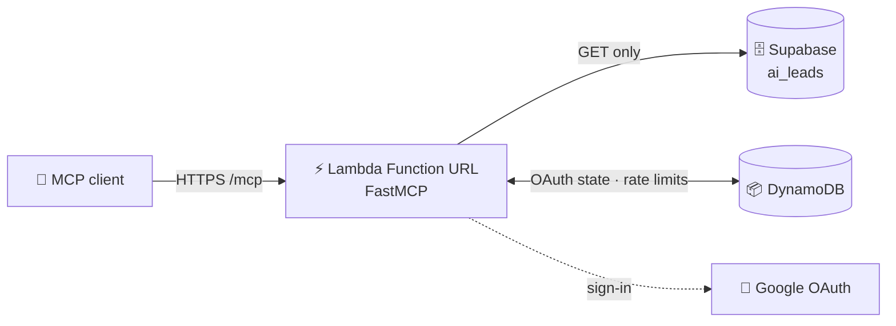

# 🎯 AI Jobs MCP

Ask Claude, Cursor or any MCP client about **AI job leads** from job boards and career pages
(Ashby, Greenhouse, Lever, Indeed, …), stored in Supabase `ai_leads`.

**Read-only** · **Google sign-in** · **2 tool calls / min / IP** · **AWS Lambda, eu-central-1**

**Server URL**

```
https://colrcdcmzfsme424n4wr4dehfi0mehor.lambda-url.eu-central-1.on.aws/mcp
```

---

## 🚀 Use it in Claude Code

1. Install (once):
   ```bash
   claude mcp add --transport http -s user ai-jobs https://colrcdcmzfsme424n4wr4dehfi0mehor.lambda-url.eu-central-1.on.aws/mcp
   ```
2. Start a **new** `claude` session → `/mcp` → `ai-jobs` → **Authenticate** → **Allow** → sign in with Google.
3. Ask, and name the server:
   ```
   Use the ai-jobs MCP: find "forward deployed engineer" jobs from the last 30 days and rank the top 10 skills to learn.
   ```

You sign in once. Claude Code stores and refreshes the tokens.

**Other clients**

| Client | How |
|---|---|
| 💬 Claude.ai / Desktop | Settings → Connectors → **Add custom connector** → paste URL → **Connect** |
| 🖱️ Cursor | `~/.cursor/mcp.json` → `{"mcpServers": {"ai-jobs": {"url": "<URL>"}}}` |
| 🧪 Terminal | `uv run test_client.py --oauth --url <URL>` (`--logout` clears tokens) |

### 🧰 Tools

| Tool | What it does |
|---|---|
| `search_leads` | Keywords + filters (company, location, source, status, seniority, remote, skills, min score, last N days), sort, paging |
| `get_lead` | All fields of one lead: description, requirements, skills gap, company research |
| `lead_stats` | Counts by any column, e.g. `source`, `company`, `required_skills` |
| `describe_leads_schema` | Columns + types, for custom `filters` |
| `whoami` | Signed-in Google account |

---

## 🏗️ Architecture



Read-only: the server sends only `GET` requests, and a test enforces it. Secrets stay server-side. Cost: within the free tier.

---

## 🛠️ Develop

```bash
uv sync
cp .env.example .env                    # fill in
uv run server.py                        # http://localhost:8000/mcp
AUTH_DISABLED=true uv run server.py     # local only, no sign-in
uv run pytest && uv run ruff check .
```

## ☁️ Deploy

```bash
AWS_PROFILE=claude ./deploy.sh          # build + SAM deploy, prints URL
```

| Task | Command |
|---|---|
| 📜 Logs | `AWS_PROFILE=claude uvx --from aws-sam-cli sam logs --stack-name ai-jobs-mcp --tail --region eu-central-1` |
| 🧹 Tear down | `AWS_PROFILE=claude uvx --from aws-sam-cli sam delete --stack-name ai-jobs-mcp --region eu-central-1` |
| ✅ Health | `curl https://colrcdcmzfsme424n4wr4dehfi0mehor.lambda-url.eu-central-1.on.aws/health` |

**Google OAuth client** (once): Cloud Console → Credentials → OAuth client ID → *Web application*.
Redirect URIs: `<base-url>/auth/callback` and `http://localhost:8000/auth/callback`.

## 📁 Files

| File | Purpose |
|---|---|
| `server.py` | FastMCP app: tools, auth, `/health` |
| `leads.py` | Supabase REST client |
| `auth.py` | Google OAuth + verified-email check |
| `ratelimit.py` | Per-IP rate limit |
| `branding.py` | Logo, `/terms`, `/privacy`, consent page |
| `config.py` | Settings from env / `.env` |
| `template.yaml` · `deploy.sh` · `run.sh` | SAM stack · deploy · Lambda entrypoint |
