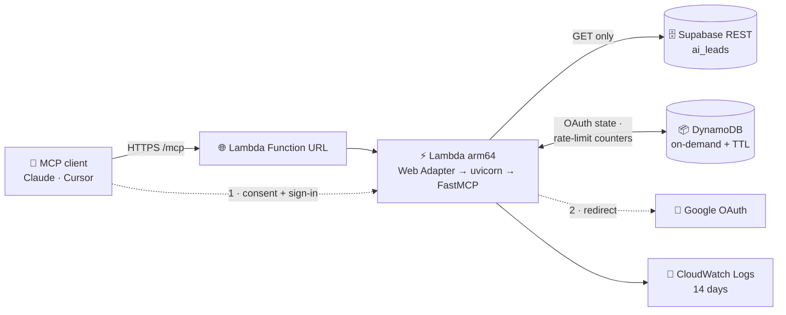

# 🎯 AI Jobs MCP

Ask Claude, Cursor or any MCP client about **AI job leads** collected from job boards and career pages
(Ashby, Greenhouse, Lever, Indeed, …), stored in Supabase `ai_leads`.

> *"Find remote senior AI engineer roles from the last 7 days that need Python"* · *"Which sources bring the most leads?"* ·
> *"Show me everything about lead X: requirements, skills gap, company research"*

**Read-only** · **Google sign-in, any verified email** · **2 tool calls / min / IP** · **AWS Lambda, eu-central-1**

---

## 🚀 Use it

**Server URL**

```
https://colrcdcmzfsme424n4wr4dehfi0mehor.lambda-url.eu-central-1.on.aws/mcp
```

| Client | How |
|---|---|
| 🤖 **Claude Code** | `claude mcp add --transport http ai-jobs <URL>`, then in `claude`: `/mcp` → `ai-jobs` → **Authenticate** |
| 💬 **Claude.ai / Desktop** | Settings → Connectors → **Add custom connector** → paste URL → **Connect** |
| 🖱️ **Cursor** | `~/.cursor/mcp.json` → `{"mcpServers": {"ai-jobs": {"url": "<URL>"}}}` |
| 🧪 **Terminal** | `uv run test_client.py --oauth --url <URL>`. Signs in once, caches tokens in `~/.cache/ai-jobs-mcp`; `--logout` clears them |
| 🔍 **Inspector** | `npx @modelcontextprotocol/inspector` → Streamable HTTP → `<URL>` |

On first connect the browser opens the **AI Jobs consent page** (logo, Terms, Privacy). Click **Allow**, then sign in
with Google. **You sign in once.** Clients store the tokens and refresh them silently; Google issues refresh tokens via
`access_type=offline`. You sign in again only after `--logout`, after revoking access in your Google account, or when
Google's refresh token expires: after **7 days while the Google app is in *Testing***, and after about 6 months unused
once it's published.

### 🧰 Tools

| Tool | What it does |
|---|---|
| `search_leads` | Keywords + filters (company, location, source, status, seniority, remote, skills, min score, last N days), sort, paging |
| `get_lead` | Every field of one lead: description, requirements, matched/missing skills, company research |
| `lead_stats` | Counts by any column, e.g. `source`, `company`, `required_skills` |
| `describe_leads_schema` | Columns + types, for custom `filters` |
| `whoami` | Signed-in Google account |

---

## 🏗️ Architecture



| Piece | Role | Why this one |
|---|---|---|
| 🌐 **Function URL** | Public HTTPS endpoint | Free, no API Gateway |
| ⚡ **Lambda** (arm64, zip, 512 MB) | Runs the FastMCP server via the Lambda Web Adapter layer | Pay per request; Graviton about 20% cheaper; no Docker/ECR |
| 🔐 **Google OAuth** (FastMCP `GoogleProvider`) | Sign-in. The server registers MCP clients itself (DCR), because Google can't | Any verified Google email; nothing to manage |
| 📦 **DynamoDB** | Encrypted OAuth state + per-IP rate-limit counters | Shared across Lambda instances; items expire via TTL |
| 🗄️ **Supabase REST** | Source of the leads | GET only; columns checked against the live schema |

**💸 Cost:** within the Lambda and DynamoDB free tiers at personal traffic, so about cents per month. No API Gateway, VPC, NAT or container registry.

### 🔒 Safety

- **Read-only by design:** the server only sends `GET` requests, every tool is annotated read-only, and a test enforces both.
- **Rate limit:** 2 *tool calls* per minute per IP (`RATE_LIMIT_PER_MINUTE`). Handshake and sign-in requests don't count. The IP
  comes from the Function URL request context, which callers can't spoof.
- **Secrets** (Supabase secret key, Google secret, JWT key) stay server-side as Lambda env vars and are never sent to clients.
- Lambda renames the 401 `WWW-Authenticate` header. Clients fall back to `/.well-known/oauth-protected-resource/mcp`
  as the MCP spec requires (SEP-985).

---

## 🛠️ Develop

```bash
uv sync
cp .env.example .env                    # fill in; see comments inside
uv run server.py                        # http://localhost:8000/mcp (Google sign-in)
AUTH_DISABLED=true uv run server.py     # local only: no sign-in
uv run test_client.py [--oauth]         # call it
uv run pytest && uv run ruff check .    # tests + lint
```

## ☁️ Deploy

```bash
AWS_PROFILE=claude ./deploy.sh          # uv builds Linux arm64 zip → SAM deploys → prints URL + Google redirect URI
```

| Task | Command |
|---|---|
| 📜 Logs | `AWS_PROFILE=claude uvx --from aws-sam-cli sam logs --stack-name ai-jobs-mcp --tail --region eu-central-1` |
| 🧹 Tear down | `AWS_PROFILE=claude uvx --from aws-sam-cli sam delete --stack-name ai-jobs-mcp --region eu-central-1` |
| ✅ Health | `curl https://colrcdcmzfsme424n4wr4dehfi0mehor.lambda-url.eu-central-1.on.aws/health` |
| 🔌 AWS MCP for Claude | `claude mcp add aws-api -s user -e AWS_PROFILE=claude -e AWS_REGION=eu-central-1 -- uvx --with "cryptography<49" awslabs.aws-api-mcp-server@latest` |

**Google OAuth client** (one time): Cloud Console → Credentials → OAuth client ID → *Web application*, with these redirect URIs:
`<base-url>/auth/callback` and `http://localhost:8000/auth/callback`. In Google Auth Platform, fill in **Branding**
(name, support + developer email, links to `/`, `/privacy`, `/terms`), then **Audience → Publish app**. Only
`openid` + `email` are requested, so Google requires no review.

## 📁 Files

| File | Purpose |
|---|---|
| `server.py` | FastMCP app: tools, auth, middleware, `/health` |
| `leads.py` | Supabase REST client: safe filters, search, stats |
| `auth.py` | Google OAuth proxy + verified-email check |
| `ratelimit.py` | Per-IP tool-call limit (DynamoDB / memory) |
| `branding.py` | Logo, `/` `/terms` `/privacy`, consent-page footer |
| `config.py` | Settings from env / `.env` |
| `template.yaml` · `deploy.sh` · `run.sh` | SAM stack · build + deploy · Lambda entrypoint |
| `.claude/` | Claude Code hooks: ruff on every edit, concision pass per turn |
